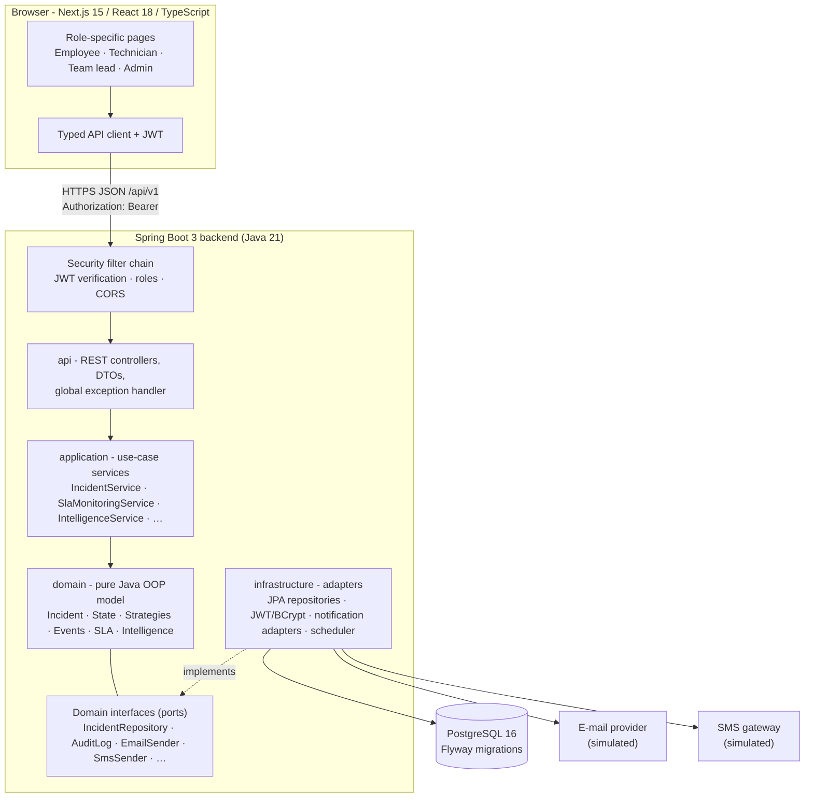
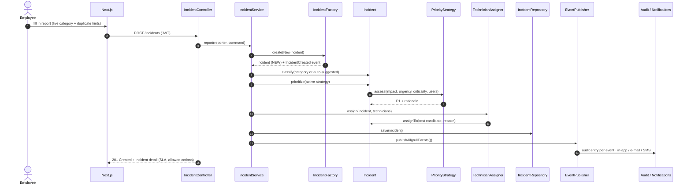
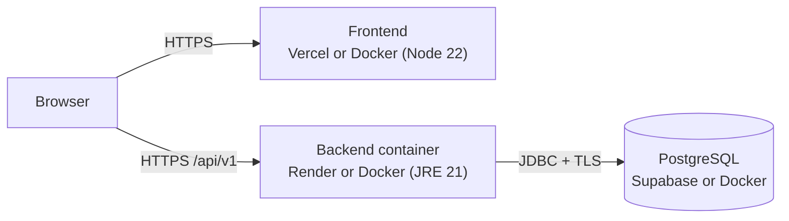

# System Architecture

## 1. Overview

ServiceDesk is a **layered (hexagonal-style) web application**: a browser client talks to a
stateless REST API; the API delegates to application services; those orchestrate a
framework-free **domain model**; infrastructure adapters connect the domain to the database, the
security framework and external notification providers.

**Dependency rule:** arrows point inwards. `api` → `application` → `domain`; `infrastructure`
implements interfaces declared by the domain. The **domain depends on nothing** - no Spring, no
JPA, no infrastructure. This is enforced on every build by ArchUnit (`DomainIsolationTest`).

## 2. Layers and responsibilities

| Layer (package) | Responsibility | Examples | Size |
|---|---|---|---|
| `domain` | Business concepts, rules and algorithms; no I/O | `Incident`, `IncidentState`, `PriorityStrategy`, `AssignmentStrategy`, `SlaCalculator`, `IncidentEvent`, `NotificationDispatcher`, `DuplicateDetector` | ~150 classes, 22 interfaces |
| `application` | Use cases: load → ask the domain → save → publish events; transactions; read visibility | `IncidentService`, `AuthService`, `AdminService`, `ReportService`, `SlaMonitoringService`, `IntelligenceService` | 14 classes |
| `api` | HTTP: routes, request validation, JSON views, error mapping | `IncidentController`, `AdminController`, `GlobalExceptionHandler` | 16 classes, 55 endpoints |
| `infrastructure` | Technology: persistence, security, notification adapters, scheduling, wiring | `JpaIncidentRepository`, `JwtAccessTokenIssuer`, `MailServiceEmailAdapter`, `DomainConfig`, `DemoDataSeeder` | ~40 classes |
| `frontend` | Role-specific user interface | report form, incident page, queue, dashboard, admin console | 10 pages |

## 3. Key flows

### 3.1 Reporting an incident (brief's 14-step scenario, steps 1-9)

### 3.2 Background SLA monitoring and escalation (steps 10-12)

Every 60 s `SlaMonitorScheduler` calls `SlaMonitoringService.runCheck()`:

1. Load open incidents; build an `SlaCalculator` from the current policies.
2. `SlaMonitor` evaluates both clocks of each incident and returns only **new** warnings and
   violations (remembered in `sla_alerts`).
3. Each alert is published as an `SlaAlertRaised` event → audit + notifications.
4. `EscalationPolicy` decides whether an unacknowledged P1/P2 must go up a level; the incident
   records `IncidentEscalated` and, at level 1, is reassigned to a team lead.

### 3.3 Request handling and errors

`JWT filter → ActiveUserJwtConverter (reload user, reject if deactivated) → URL rules →
@PreAuthorize → controller → service → domain checks`. Any `DomainException` is translated by
`GlobalExceptionHandler` into one JSON error format with a stable code (e.g. 409
`INVALID_STATE_TRANSITION`).

## 4. Why this architecture

| Decision | Reason | Alternative considered |
|---|---|---|
| **Framework-free domain** | The OOP model *is* the project: it must be readable, testable without a server, and free of annotations that blur responsibilities | Annotating domain classes as JPA entities (simpler, but mixes persistence into business objects and allows public setters) |
| **Domain events + Observer** | Audit, notifications and cache refresh react to *what happened* without the incident knowing about them; adding a listener changes nothing else | Calling audit and notification services from every method (easy to forget one; tight coupling) |
| **Repository interfaces in the domain** | The domain states what it needs; persistence is a replaceable detail (in-memory in tests, JPA in production) | Spring Data repositories used directly by services |
| **Stateless REST + JWT** | Horizontal scaling, simple frontend, mobile-ready | Server sessions (sticky sessions, CSRF handling) |
| **Monolith with clear modules** | One deployable for a small team and a short timeline; module boundaries already follow future service boundaries | Microservices (operational overhead without benefit at this scale) |
| **Separate Next.js frontend** | Rich role-specific UI; can be deployed to a CDN (Vercel) independently | Server-rendered templates (Thymeleaf) |

## 5. Deployment

- **Local:** `docker compose up` starts PostgreSQL, backend and frontend; or run
  `LocalDevApplication` (embedded PostgreSQL, no Docker).
- **Cloud:** backend on Render (Docker), frontend on Vercel, database on Supabase (profile `cloud`
  enforces SSL).
- **CI:** GitHub Actions runs formatting checks, all backend tests with coverage, frontend lint,
  typecheck and build, and Docker image builds on every pull request.

## 6. Scalability path

| Growth | Change needed |
|---|---|
| More users / requests | Run several backend instances behind a load balancer (stateless API already allows it); add a connection pooler |
| Many more incidents | Partition or archive closed incidents; add full-text search (PostgreSQL `tsvector` or OpenSearch) behind `IncidentRepository` |
| Heavy notification volume | Publish domain events to a message broker (Kafka/RabbitMQ) and deliver asynchronously - a new `IncidentEventListener`, no domain change |
| SLA monitor across instances | Single scheduler via a distributed lock (ShedLock) or a dedicated worker |
| AI-based intelligence | New implementations of `CategoryClassifier` / `TextSimilarity` calling an ML service |
