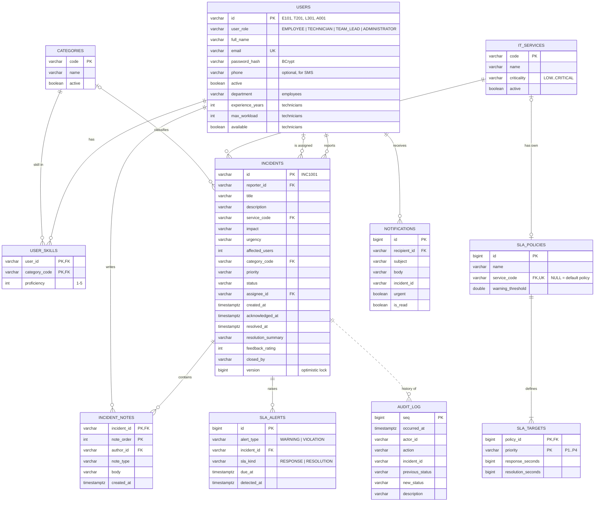

# Database

PostgreSQL 16 in development and production (Docker Compose locally, Supabase in the cloud).
The schema is created and evolved only by **Flyway** migrations in
`backend/src/main/resources/db/migration`; Hibernate runs with `ddl-auto: validate`, so the
application refuses to start if the Java mapping and the database disagree.

| Migration | Contents |
|---|---|
| `V1__baseline.sql` | Empty baseline (template) |
| `V2__schema.sql` | All tables, keys, checks and indexes |
| `V3__seed_reference_data.sql` | Categories, IT services, SLA policies, demo accounts |

## Why PostgreSQL

- Incidents, users, services and SLA policies are strongly related, and the relationships must
  stay consistent (an incident can only point at a real service and a real user). A relational
  database with foreign keys and check constraints enforces this; a document store would leave
  it to application code.
- Reporting needs grouping and counting (incidents per service, per technician, SLA violations
  per month), which SQL does natively.
- It is free, runs locally in Docker and is offered as a managed cloud service (Supabase), so
  the same database is used from laptop to deployment.

## ER diagram

## Design decisions

| Decision | Reason |
|---|---|
| **One `users` table** for all roles, with a `user_role` column | The Java `User` hierarchy (Employee, Technician, TeamLead, Administrator) differs in only a few columns. Single-table mapping keeps queries simple; `UserFactory` rebuilds the right subclass from the role. |
| **Workload is not stored** | A technician's open-incident count is computed from `incidents` when the technician is loaded, so it can never drift out of sync. |
| **Notes, resolution, feedback and closure belong to the incident** | They are *composition* in the domain model: notes have their own table with `ON DELETE CASCADE`; the others are columns on `incidents`. |
| **Categories and services are tables, not enums** | Administrators can add a new category or service at runtime without a code change. |
| **`audit_log` has no foreign keys and is append-only** | History must survive even if referenced rows are archived, and automatic actions are performed by the `SYSTEM` actor, which is not a user row. The code has no update or delete path for it. |
| **`sla_alerts` unique on (incident, kind, type)** | Guarantees each warning and violation is recorded once, even if two monitor runs overlap. |
| **`version` column on `incidents`** | Optimistic locking: if two people change the same incident at the same time, the second save fails instead of silently overwriting the first. |
| **Enum-like values stored as text + `CHECK`** | Readable in SQL tools and reports, portable between PostgreSQL and H2. |
| **Human-readable keys** (`INC1024`, `E102`, `PAYMENT`) | People quote them on the phone and in e-mails. Ids come from database sequences (`incident_seq`, `user_seq`). |

## How Java objects map to tables (Repository pattern)

The domain layer defines repository **interfaces** (`IncidentRepository`, `UserRepository`,
`SlaPolicyRepository`, `AuditLog`, ...). The `infrastructure.persistence` package implements them
with Spring Data JPA. JPA entities are plain data holders; mappers convert between them and the
domain objects. An `Incident` is saved through its `IncidentSnapshot` (Memento pattern), so it
keeps its fields private and needs no setters.

## Sample data (V3)

- **9 categories**: Hardware, Software, Network, Database, Cloud, Security, Authentication,
  Application, Storage.
- **11 IT services** from Payment Gateway (CRITICAL) to Printing (LOW).
- **SLA policies**: the standard table from the brief as the default, plus a tighter
  "Payments Gold" policy for the payment service (P1: 2 min / 15 min).
- **Demo accounts**: 1 administrator, 2 team leads, 6 technicians with skills, 6 employees. All
  use the password documented at the top of `V3__seed_reference_data.sql`. They exist for
  development and demonstrations only.

Sample incidents will be created at start-up through the domain model (planned for Phase 5, with
the application services), so each one gets a correct priority, SLA, assignment and audit trail
instead of hand-written SQL rows that could contradict each other.

## Testing the schema

- Every test run applies the real migrations to H2 (PostgreSQL mode) and validates the mapping.
- `PostgresCompatibilityTest` starts a real PostgreSQL server in-process (zonky
  embedded-postgres, no Docker needed) and runs the migrations, schema validation and an
  incident round-trip against it.
