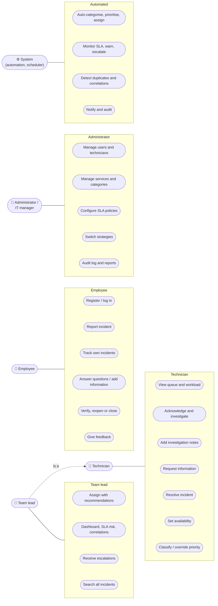
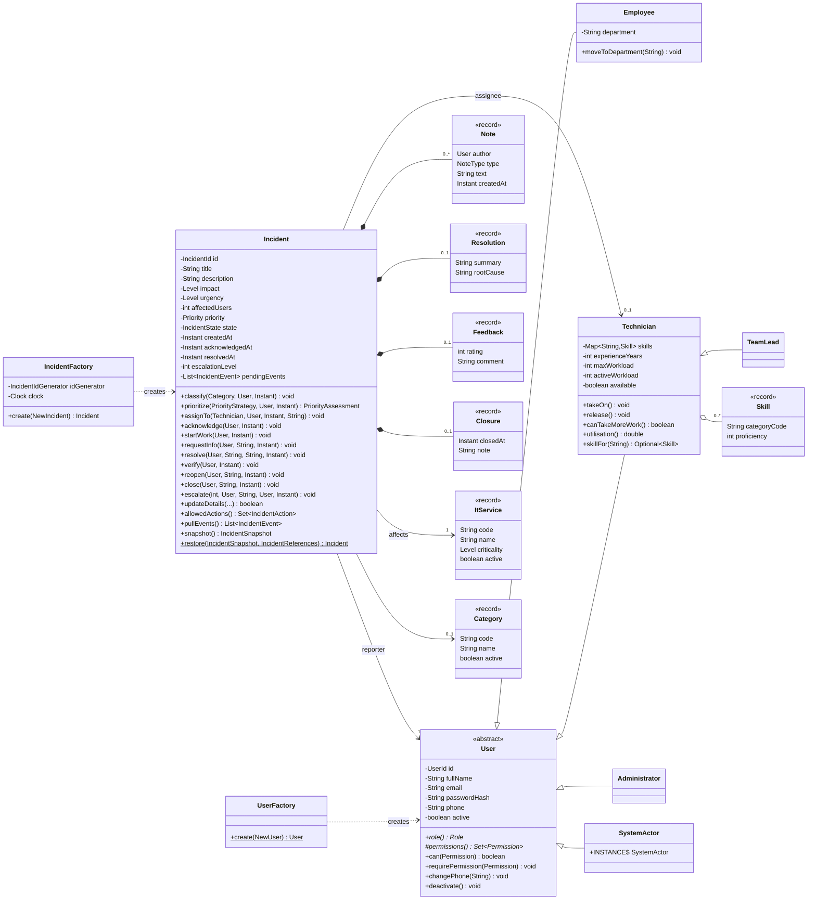
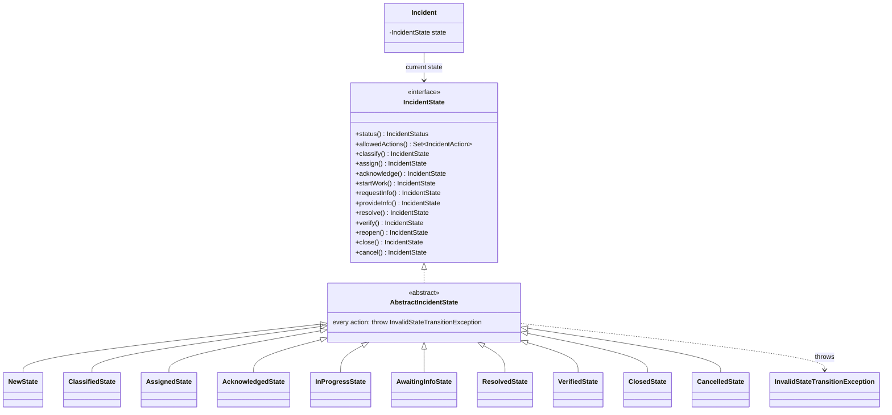
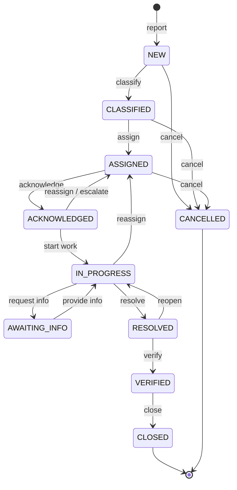
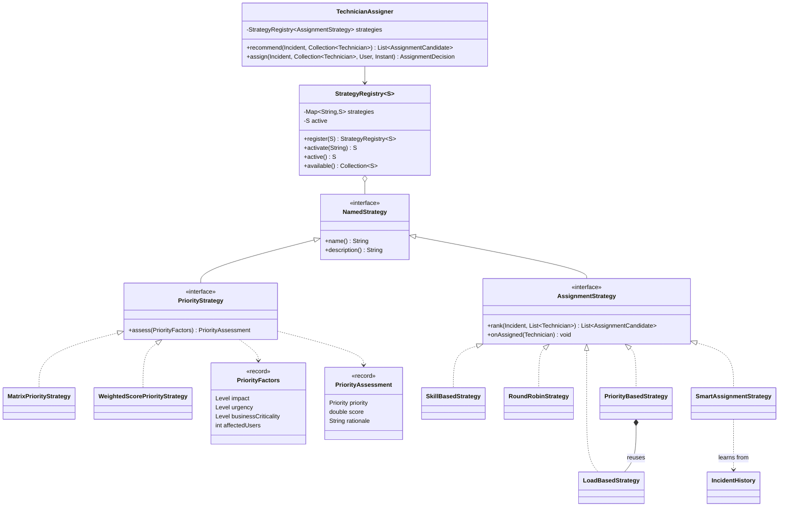
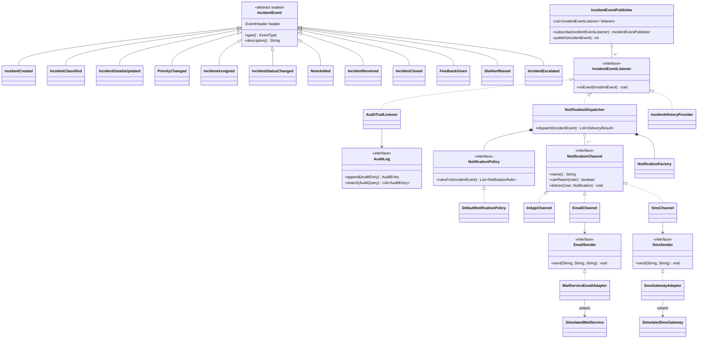
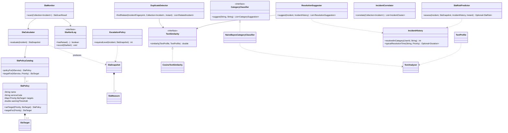
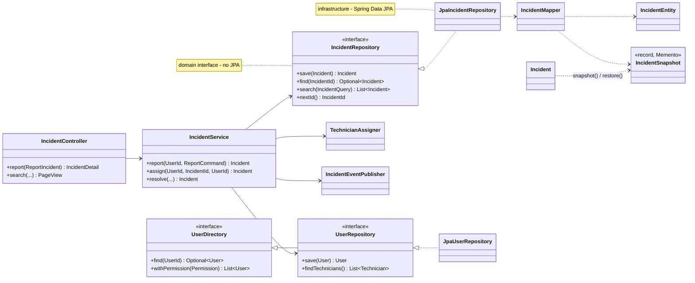

# UML Diagrams

Diagrams are written in [Mermaid](https://mermaid.js.org/) so they render on GitHub and stay in
version control next to the code. Notation in class diagrams:

| Symbol | Meaning |
|---|---|
| `<|--` | inheritance (is-a) |
| `<|..` | implements an interface |
| `*--` | composition (part cannot exist without the whole) |
| `o--` | aggregation (whole has parts with their own life) |
| `-->` | association |
| `..>` | dependency / uses |

## 1. Use case diagram

Each actor is linked to the group of use cases it can perform. A **team lead is a technician**
(inherits every technician use case) with extra rights, and the **administrator** has all team-lead
use cases plus configuration. Reporting an incident *includes* the automated classify → prioritise
→ assign → notify sequence.

## 2. Class diagram - users and the incident aggregate

## 3. Class diagram - State pattern (incident lifecycle)

### Lifecycle (state machine)

## 4. Class diagram - Strategy pattern (priority and assignment)

## 5. Class diagram - Observer pattern, notifications, audit, adapters

## 6. Class diagram - SLA and intelligent features

## 7. Class diagram - layers, Repository pattern and Memento

